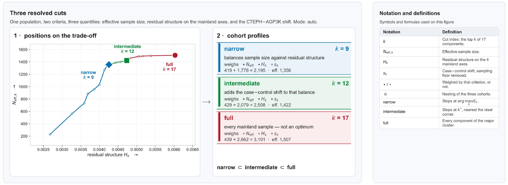
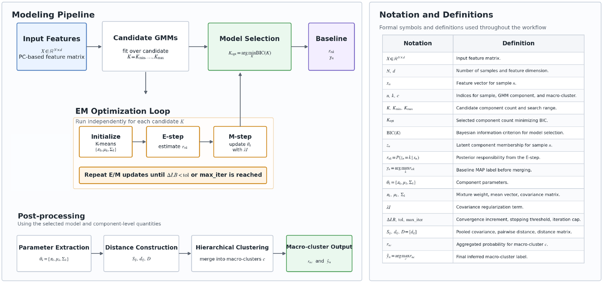
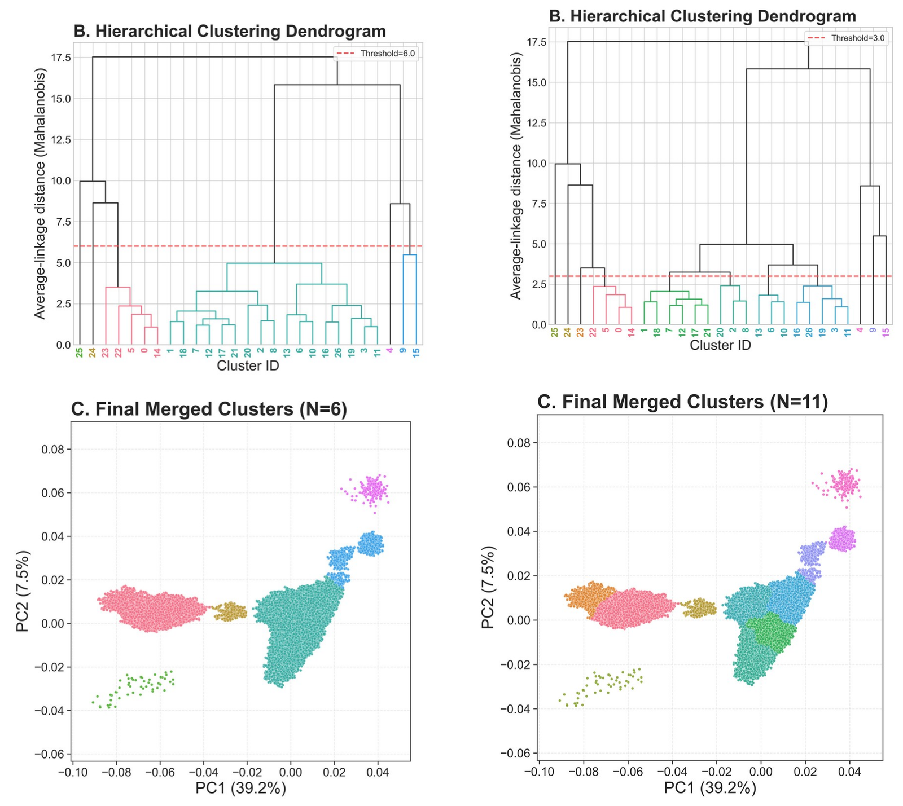

# PopGMM

**Probabilistic ancestry modeling and population-stratification control for case–control association studies, with PCA and Gaussian mixture models.**

PopGMM learns the population structure of a reference panel in PCA space. It then assigns every study sample a probabilistic ancestry under that model, without refitting.

From these assignments it selects ancestry-matched case–control sets for GWAS:
- three nested sets, narrow ⊂ intermediate ⊂ full;
- each delivered as a PLINK keep list;
- each with its cost reported: effective sample size against the residual structure it keeps.



*The three cohorts of the first application. Left: their positions on the trade-off between effective sample size (N<sub>eff</sub>) and residual structure on the target-population axes. Right: their composition.*

## Purpose

**Stratification biases a case–control study in both directions.**
- **False positives.** Allele frequencies differ between ancestral groups, also at variants unrelated to disease. If cases and controls come from these groups in different proportions, a non-causal variant shows a case–control frequency difference and looks associated (Thomas & Witte, 2002).
- **False negatives.** A risk variant that is frequent in only one group is diluted when heterogeneous samples are pooled, and power is lost.

Ancestry must therefore be matched before the association analysis.

**Population structure does not come in boxes.**
- Ancestry changes gradually across geography, so hard clustering cuts continuous variation at artificial boundaries.
- Many individuals carry ancestry from several groups and lie between clusters.
- In PC space, populations form elongated ellipsoids rather than round clouds (Novembre & Stephens, 2008).

Common approaches handle this poorly:
- fixed cutoffs on the leading PCs impose box- or sphere-shaped boundaries;
- nearest-neighbor methods (e.g. Riikonen et al., 2026) depend on K, on the composition of the reference and on local sampling density;
- density clustering such as HDBSCAN gives hard labels only, and is unstable for small or sparse groups.

None of them gives a soft membership that follows the shape of a population.

**A Gaussian mixture fits that shape.**
- Each component is an ellipsoid with its own covariance, so tight and diffuse populations can sit side by side.
- Components may overlap, and every sample receives posterior probabilities that also measure how confident its assignment is.

Fitted once on a reference panel, the model assigns ancestry to any cohort projected into the same PC space, without retraining.

## How it works



*Modeling the reference panel. Candidate GMMs are fitted by EM over a range of K, and BIC selects K. The selected components are then merged into ancestry clusters by hierarchical clustering on their pairwise distances.*

**Reference model.** The reference model never sees a phenotype.

1. **Shared PC space.** Reference and study samples are projected on the same loadings, computed from the variants both datasets share.
2. **Denoise.** HDBSCAN flags low-density reference samples in the margins and transition zones. Left in, they would pull components into the gaps and push BIC toward spurious components.
3. **Fit.** Full-covariance Gaussian mixtures are fitted over a range of component numbers; BIC selects the number.
4. **Merge.** Components are merged into ancestry clusters by average-linkage clustering on their Mahalanobis distances.

**Study cohort.** The cohort is placed in the model without refitting.

5. **Assign.** Each sample receives a posterior probability for every component. The posteriors are summed per merged cluster, and the largest sum is the sample's assignment confidence.
6. **Rank.** Within the target cluster, the PCs are re-estimated on that cluster's reference samples, and its fine-scale components are ranked by case/control ratio.
7. **Cut.** Components are added in ranking order. Each cut k is scored on effective sample size, residual structure, and the case–control shift. Two stated rules pick two of the cuts:
   - **narrow** weighs effective sample size against residual structure, and stops where extra effective sample size no longer pays for the residual structure it adds. The case–control shift plays no part.
   - **intermediate** adds the case–control shift. Residual structure and shift are weighted equally, and the cut nearest the ideal corner is taken. The same cut wins over a wide range of weights.
   - **full** weighs nothing: every ranked component, the population the other two are cut from.
8. **Diagnose.** The case and control distributions of each cohort are compared on the leading PCs.

Why each stage exists, with the derivations: [`docs/method.md`](docs/method.md).

## First application

**Reference and cohort.**
- The reference is the BioBank Japan panel: 183,013 samples after QC.
- The cohort is 3,569 whole-genome-sequenced samples: 452 cases and 3,117 controls.
- Both are placed in one PC space on the 62,053 variants they share after QC and LD pruning.

**Reference model.**
- HDBSCAN flagged 1,446 reference samples (0.8%) as noise; the GMM was fitted to the remaining 181,567.
- BIC selected 27 components on PC1–PC2.
- Merged at a distance threshold of 6, the components form 6 ancestry clusters. These agree with the published regional structure of Japanese populations: Mainland, Ryukyu, Ryukyu_admix, Hokkaido_sub and EA_admix (Yamamoto et al., 2024).
- At a threshold of 3, 11 clusters follow Japanese regions and the 1000 Genomes East Asian populations.



*Component merging at distance thresholds 6 (left) and 3 (right). Top: average-linkage dendrogram of the 27 components on their Mahalanobis distances; the dashed line is the cut. Bottom: the merged clusters on PC1–PC2 of the reference panel.*

**Cohorts.** Within the mainland cluster, 17 components were ranked, giving three nested cohorts. Both rules resolved their cuts automatically and agree with the hand-set values. The intermediate cut, k = 12, is the same for every weight from 0.37 to 0.71.

| Cohort | Cut | Samples (cases + controls) | Effective sample size | Residual structure (mainland PCs) |
|---|---|---:|---:|---:|
| narrow | k = 9 | 2,195 (419 + 1,776) | 1,356 | 0.00425 |
| intermediate | k = 12 | 2,508 (429 + 2,079) | 1,422 | 0.00473 |
| full | k = 17 | 3,101 (439 + 2,662) | 1,507 | 0.00603 |

The cohorts are analyzed together, and an association that holds in all three is robust to the choice of cut.

Matching does not remove every case–control difference. In the narrow cohort, whose rule does not weigh the shift, cases and controls still differ on PC1 and PC2 (FDR-adjusted P < 10⁻⁶, in both the global and the mainland PCs). The per-PC tests of each cohort are in `results/04_subcluster_variants/`.

## What you get

| File in `results/keep_lists/` | Contents |
|---|---|
| `narrow_mainland.fid_iid.txt` | the narrow cohort: effective sample size weighed against residual structure |
| `intermediate_mainland.fid_iid.txt` | the intermediate cohort: the case–control shift weighed as well |
| `full_mainland.fid_iid.txt` | every ranked component of the target cluster |
| `reference_full_mainland.fid_iid.txt` | the reference samples in the same cluster |
| `keep_list_summary.tsv` | the lists side by side: the cut each came from, counts, balance, effective sample size, residual structure |

The lists hold individual sample IDs, so a run writes them locally and they are not kept in this repository; `keep_list_summary.tsv` is. Each list is a headerless, tab-separated `FID IID` file for PLINK:

```bash
plink2 --pfile <dataset> \
  --keep results/keep_lists/narrow_mainland.fid_iid.txt \
  --make-pgen \
  --out <dataset>.popgmm
```

Posterior probabilities, model-selection evidence, diagnostic figures and run provenance accompany the lists, so every list can be traced to the decisions that produced it ([`docs/outputs.md`](docs/outputs.md)).

## Install

```bash
conda env create -f environment.yml
conda activate popgmm
python -m ipykernel install --user --name popgmm --display-name popgmm
```

## Run

Open [`workflow.ipynb`](workflow.ipynb), select the `popgmm` kernel, and run all cells from the repository root.

Three environment variables redirect a run without editing the source. Set them before the kernel starts; they are read at import:

```bash
POPGMM_DATA_ROOT=/path/to/data
POPGMM_RESULTS_ROOT=/path/to/results
POPGMM_RUN_MODE=resume            # default: fresh
```

Use `fresh` for any final analysis. `resume` reuses cached upstream computations: the numbers are the same, but the cached stages write no files. The result tree is then a mix of two runs, and `tools/verify_results.py` refuses to verify it.

## Inputs

| Input | Content |
|---|---|
| PCA eigenvalue file | one eigenvalue per line, used to report explained variance |
| PLINK2 `--score` file (`.sscore`) | `FID`, `IID`, phenotype, and the PC score columns, numerically ordered |

PC columns are detected as `PC<n>` or `PC<n>_AVG`. The study scores must be projected from the same reference loadings as the reference scores; PopGMM does not reconcile different PCA coordinate systems.

Inputs live under `data/` and are not tracked. Paths, cohort labels, seeds and the cut mode are set in [`scripts/params.py`](scripts/params.py). Under the default `RANK_CUT_MODE = "auto"`, the cuts are resolved by their rules, and the hand-set values are kept beside them as a cross-check.

## Outputs

```text
results/
├── keep_lists/              the deliverable, above
├── 01_reference_model/      denoising, mixture fit, component merging
├── 02_cohort_assignment/    per-sample posteriors and confidence
├── 03_rank_selection/       the three quantities, the two rules, the cuts
├── 04_subcluster_variants/  narrow, intermediate, full
└── provenance/              configuration and environment snapshots
```

Every file is described in [`docs/outputs.md`](docs/outputs.md).

## Limitations

- PopGMM describes structure within the supplied reference PCA space. It does not infer ethnicity, identity or ancestry independently of that reference.
- The target cluster is defined by the algorithm; its display name is an interpretation, not a label the model discovered.
- The cuts are points on a trade-off, not biological boundaries. A narrower cohort buys less residual structure with effective sample size, and a broader one the reverse. Each cut is derived by its rule (`RANK_CUT_MODE = "auto"`) or set by hand (`"manual"`); both answers are computed and compared in `results/03_rank_selection/cut_record.tsv`.
- A more homogeneous set removes one source of stratification, not all residual structure. Covariates, relatedness handling and sensitivity analyses may still be needed.

The full list, with the reasoning: [`docs/method.md`](docs/method.md#interpretation-and-limitations).

## Documentation

| Document | Content |
|---|---|
| [`docs/method.md`](docs/method.md) | why each stage exists, with the mathematics |
| [`docs/outputs.md`](docs/outputs.md) | what every file in `results/` contains |
| [`docs/gmm_convergence_diagram.EN.md`](docs/gmm_convergence_diagram.EN.md) | EM updates, convergence, BIC, component distance, merging ([Chinese](docs/gmm_convergence_diagram.CN.md)) |
| [`docs/reproducibility_probe.md`](docs/reproducibility_probe.md) | whether the pipeline is bit-deterministic |
| [`docs/environment_snapshot.txt`](docs/environment_snapshot.txt) | the machine that produced the committed results |

## References

- Novembre, J., & Stephens, M. (2008). Interpreting principal component analyses of spatial population genetic variation. *Nature Genetics, 40*(5), 646–649.
- Riikonen, J., Kerminen, S., Havulinna, A., & Pirinen, M. (2026). KANN: estimation of genetic ancestry profiles by nearest neighbor regression. *Nucleic Acids Research, 54*(5), gkag209.
- Thomas, D. C., & Witte, J. S. (2002). Point: population stratification: a problem for case-control studies of candidate-gene associations? *Cancer Epidemiology, Biomarkers & Prevention, 11*(6), 505–512.
- Yamamoto, K., Namba, S., Sonehara, K., Suzuki, K., Sakaue, S., Cooke, N. P., … & Okada, Y. (2024). Genetic legacy of ancient hunter-gatherer Jomon in Japanese populations. *Nature Communications, 15*(1), 9780.

## Author

Zhao Tie ([@ZhaoTie-re](https://github.com/ZhaoTie-re)).
